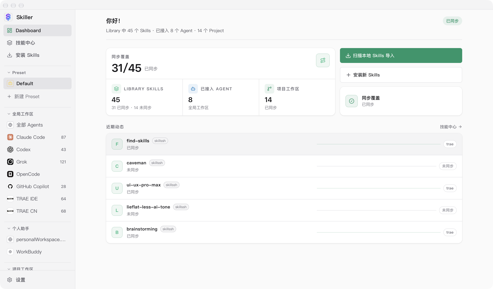
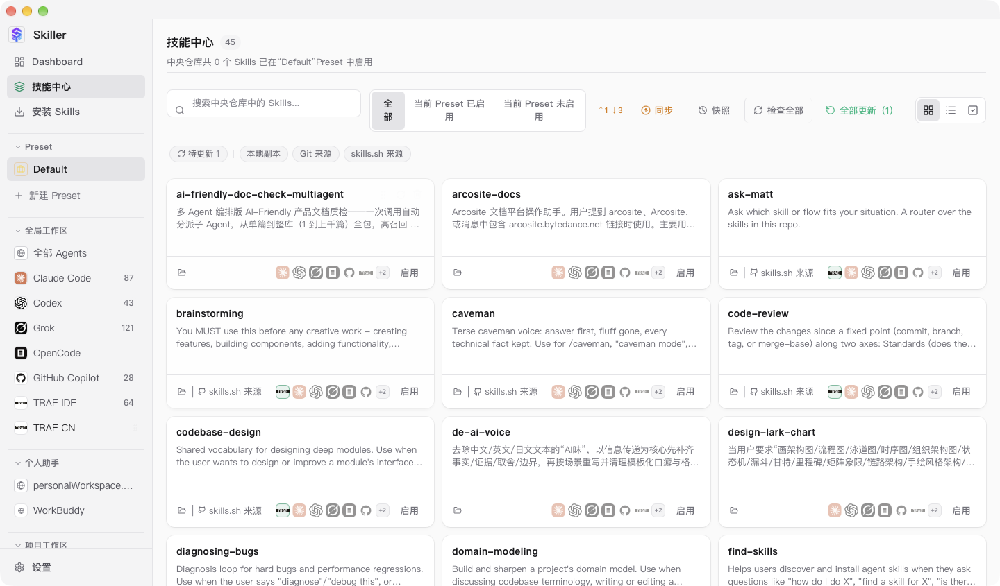
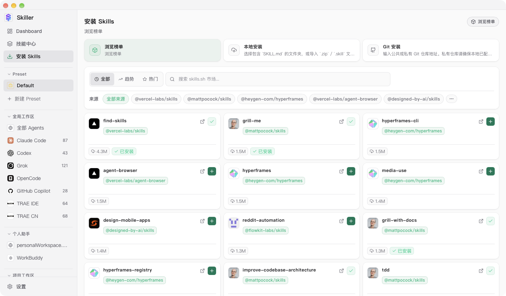
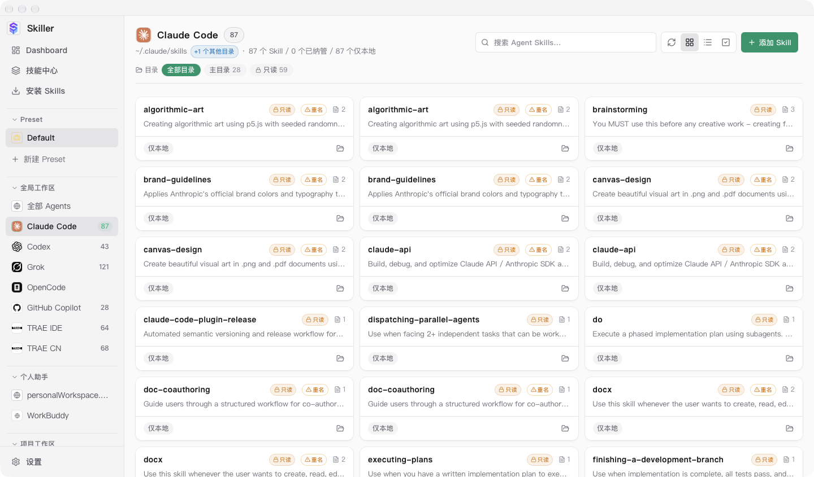

# skiller

统一、可视化管理各 AI Agent（Claude Code、Codex、Cursor、TRAE IDE / TRAE CN、Gemini CLI、GitHub Copilot、OpenCode 等 50+ 工具）的 Skills。

面向使用者的完整功能说明见 [`app/README.md`](app/README.md)（[中文](app/README.zh-CN.md)）。

## 功能概览

- **统一技能库**：从 Git 仓库、本地文件夹、`.zip` / `.skill` 归档或 [skills.sh](https://skills.sh) 市场安装 skill，统一汇入中央库（默认 `~/.skiller`）。
- **50+ Agent 支持**：Claude Code、Codex、Cursor、TRAE、Gemini CLI、GitHub Copilot、Grok、Windsurf 等开箱即用，也可添加自定义 Agent。
- **各 Agent 工作区**：每个 Agent 独立页面，列出它实际可见的全部 skill；只读厂商 skill、软链、仅本地条目各有徽章，后端写守卫保护厂商 bundle 不被破坏。
- **预设（Preset）与批量操作**：把一组 skill 存成命名预设，一键启用 / 停用；支持多选批量打标签、删除、解除链接。
- **项目工作区与同步洞察**：管理项目级 skill 目录并与中央库双向同步，显示每个 skill 的同步状态与累计触发次数。
- **Git 备份与快照**：用 Git 对技能库做版本管理、多机同步与快照恢复。

## 界面截图

Dashboard：同步覆盖率、已接入 Agent 与近期动态一屏掌握。



技能中心：中央库全部 skill，按来源 / Preset / 同步状态筛选，支持批量操作与 Git 快照。



安装 Skills：skills.sh 市场榜单，以及本地 / Git 三种安装入口。



Agent 工作区：单个 Agent 实际可见的 skill，只读、重名、仅本地状态均有徽章。



更多截图（全部 Agents 总览、设置页）见 [`docs/screenshots/`](docs/screenshots/)。

## 下载安装

普通用户无需编译，直接到 [GitHub Releases](https://github.com/myuanzhang/skiller/releases) 下载对应平台安装包（macOS `.dmg` / Windows `.exe`、`.msi` / Linux `.deb`、`.AppImage`）。打包与发布流程见 [docs/发布打包.md](docs/发布打包.md)。

## 目录结构

```
skiller/
├── AGENTS.md              # Agent 协作入口（指针 → CLAUDE.md + 文档更新规则）
├── CLAUDE.md              # 编码行为准则（单一真源 SSoT）
├── docs/                  # 文档（索引见 docs/README.md）
│   ├── 架构/              # 现行机制说明（Agent 管理、中央仓库、技能发现等）
│   ├── 协作/              # AI 协作：会话交接说明、交接 Prompt、Worktree 指南
│   ├── adr/               # 架构决策记录（ADR）
│   ├── 开发环境.md        # 本地构建与运行
│   ├── research/          # 调研资料
│   └── archive/           # 已完成的历史计划（冻结存档）
└── app/                   # 应用代码（Tauri: Rust 后端 + React/TS 前端）
    ├── src/               # 前端
    └── src-tauri/         # 后端 + CLI
```

## 快速上手（app/）

需要 Rust 工具链 + Node。

```bash
cd app
npm install
export PATH="$HOME/.cargo/bin:$PATH"
export CARGO_TARGET_DIR="/tmp/skiller-target"   # 本机需绕开构建限制
npm run tauri:dev    # 启动桌面 GUI（开发模式）
npm run cli -- --help # 运行 CLI
```

> 本机构建 `.rlib` 会遇到 `Operation not permitted`（安全软件拦截）。
> 绕过方法、产物路径与启动信号见 [`docs/开发环境.md`](docs/开发环境.md)。

## 文档

- 开发文档索引：[`docs/README.md`](docs/README.md)
- 编码准则：[`CLAUDE.md`](CLAUDE.md)

## 许可证

MIT，见 [`app/LICENSE`](app/LICENSE)。
