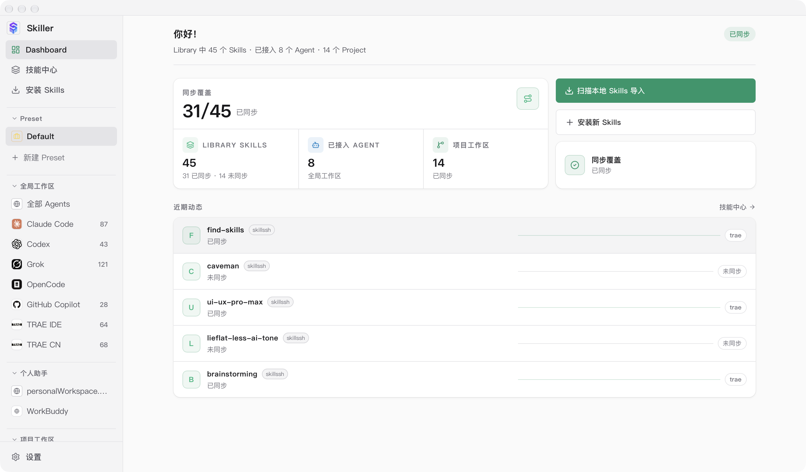
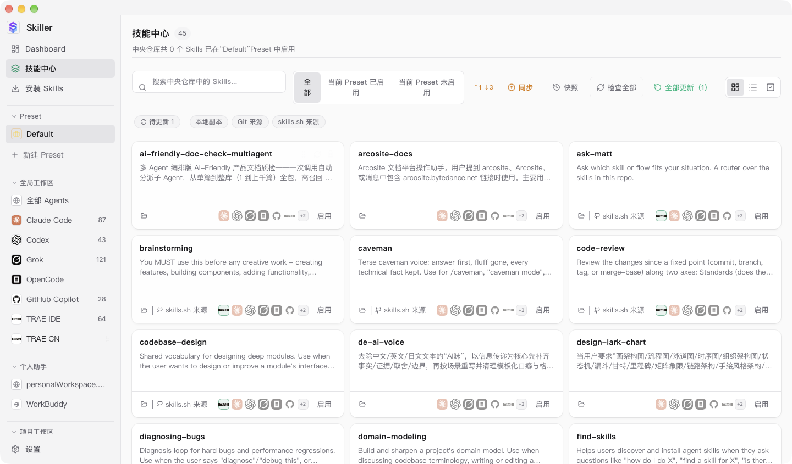
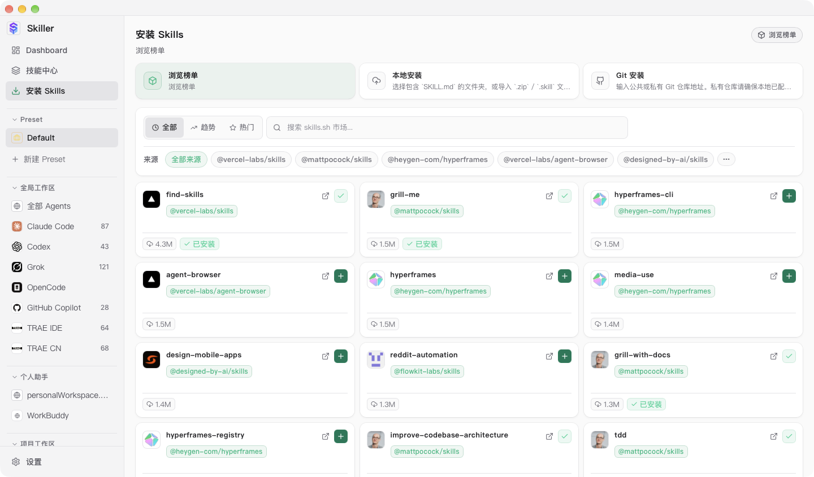
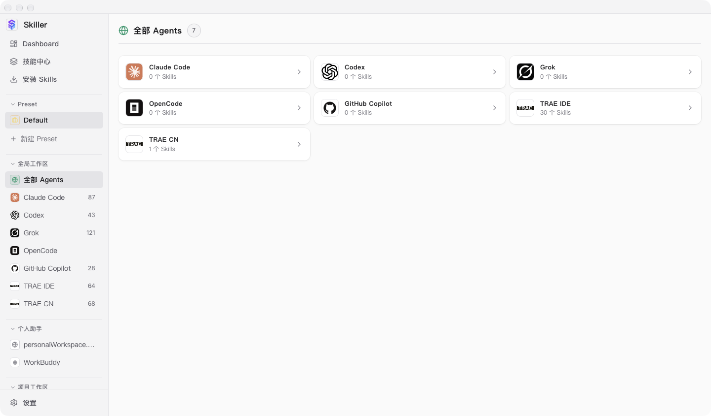
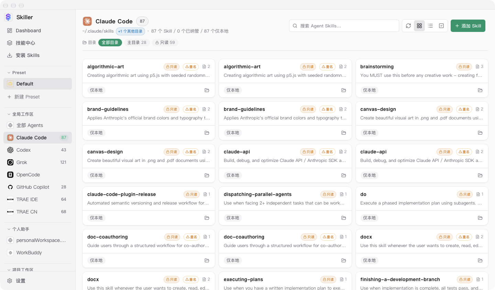
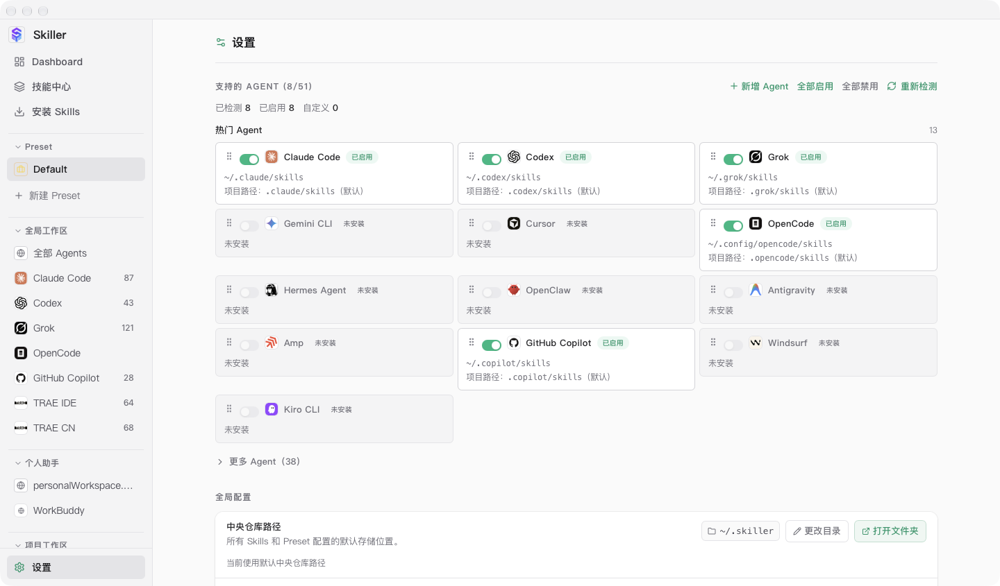

<h1 align="center">Skiller</h1>

<p align="center">
  一个统一管理各 AI Agent Skills 的桌面应用。
</p>

<p align="center">
  <a href="./README.md">English</a>
</p>

## 功能

- **统一技能库** —— 从 Git 仓库、本地文件夹、`.zip` / `.skill` 归档，或 [skills.sh](https://skills.sh) 市场安装 skill。所有 skill 汇入一个中央库，默认位于 `~/.skiller`，可在**设置**里自定义。
- **广泛的 Agent 支持** —— 开箱支持 50+ 编码与个人 AI Agent：Claude Code、Codex、Cursor、TRAE IDE / TRAE CN、Gemini CLI、GitHub Copilot、OpenCode、Grok、Windsurf、Cline 等等。
- **预设（Preset）** —— 把若干 skill 打包成命名预设。在任意工作区点击预设即可为当前 Agent 范围一键启用/停用其全部 skill。
- **各 Agent 工作区** —— 每个 Agent 有独立页面，列出它实际能看到的所有 skill（包括不是通过 Skiller 安装的，以及经 `~/.agents/skills` 共享的）。skill 按真实来源目录分组并可筛选，跨 Agent 软链、指向中央仓库的软链（`↪ 中央仓库`）和只读条目各有徽章。可按 Agent 增删，或用「全部 Agents」总览统一管理。
- **只读厂商 skill** —— 厂商托管的 skill 会带锁徽章展示：TRAE、Codex、Claude Code、Grok 自带的内置系统 skill 与插件/市场缓存都在此列。它们按厂商目录分组筛选（Codex 有两个独立只读根目录，分别标注）；后端有写守卫，禁止对它们同步、导入或删除，Skiller 不会改动或破坏厂商 bundle。
- **项目工作区** —— 查看和管理各 Agent 的项目级 skill 目录，与中央库对比并双向同步。卡片显示 skill 在已分配 Agent 下的累计触发次数，所有路径可一键在访达中打开；移走某 Agent 的最后一个 skill 后，空出来的目录会自动回收，不留空壳文件夹。
- **多工具同步** —— 一键将 skill 以软链或复制方式同步到任意受支持的工具。
- **批量操作** —— 在技能中心或任意 Agent 视图多选 skill，批量启用/停用、编辑标签、删除，或（在 Agent 视图）从该 Agent 解除链接而保留中央库副本。
- **标签与筛选** —— 给 skill 打标签，按来源、标签或同步状态筛选。
- **同步状态与使用洞察** —— 每个 Agent 本地 skill 都会显示它是「仅本地 / 已纳管 / 已同步 / 有分歧」，以及在该 Agent 下被触发了多少次。
- **更新追踪** —— 检查 Git 来源 skill 的上游更新；重新导入本地 skill。
- **自定义工具** —— 添加自己的 Agent/工具及其 skill 目录，或覆盖任意内置工具的默认路径。
- **Git 备份、快照与恢复** —— 用 Git 对技能库做版本管理，实现备份与多机同步。每次同步可生成快照，之后可浏览、恢复或删除。

## 功能截图

**Dashboard 总览** —— 同步覆盖率、已接入 Agent、项目工作区与近期动态一屏掌握。



**技能中心** —— 中央库中的全部 skill，可按来源、Preset、同步状态筛选，支持批量操作与 Git 快照。



**安装 Skills** —— 浏览 skills.sh 市场榜单，或从本地文件夹、`.zip` / `.skill` 归档、Git 仓库安装。



**全部 Agents** —— 已接入 Agent 总览，每个 Agent 的 skill 数量与状态一目了然。



**Agent 工作区** —— 单个 Agent 实际可见的全部 skill；只读厂商 skill、重名条目、仅本地状态均有徽章标注。



**设置** —— 启用 / 停用 Agent、自定义各 Agent 与中央仓库的 skill 目录、新增自定义 Agent。



## 技术栈

| 层 | 技术 |
|---|---|
| 桌面框架 | Tauri 2（Rust） |
| 前端 | React 19 + TypeScript + Vite + TailwindCSS |
| 存储 | SQLite |
| CLI | `skiller-cli`（与 GUI 共享同一 Rust core） |

## 下载安装

普通用户无需编译：到 [GitHub Releases](https://github.com/myuanzhang/skiller/releases) 下载对应平台安装包（macOS 为 `.dmg`，Windows 为 `.exe` / `.msi`，Linux 为 `.deb` / `.AppImage`）。

- macOS 首次打开若提示无法验证开发者，右键 App →「打开」放行（当前为 ad-hoc 签名，未使用 Apple Developer 证书）。
- 打包与发布流程见 [docs/发布打包.md](../docs/发布打包.md)。

## 开发

需要 Rust 工具链 + Node。

```bash
cd app
npm install
export PATH="$HOME/.cargo/bin:$PATH"
export CARGO_TARGET_DIR="/tmp/skiller-target"   # 本机需绕开构建限制
npm run tauri:dev    # 启动桌面 GUI（开发模式）
npm run cli -- --help # 运行 CLI
```

- 应用图标在 `src-tauri/icons/`，托盘图标在 `src-tauri/icons/tray/`。
- 中央库默认位于 `~/.skiller`（skills、SQLite DB、缓存、日志）。

## 许可证

MIT，见 [LICENSE](./LICENSE)。
